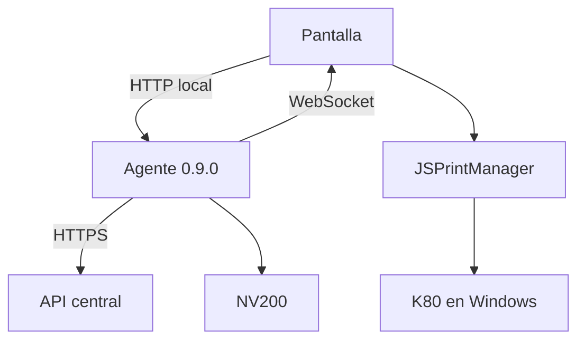

# DEMP — Frontend de estación de autoservicio

Actualización: 4 de noviembre de 2026. Agente local **0.9.0**, basado en 0.8.6. API central: entrega de autoservicio anónimo con reutilización de premios y sobrantes.

## 1. Qué integra esta entrega

La pantalla utiliza el puente local para consultar catálogo, gestionar la atención, controlar el billetero, seleccionar fondos y vender. El agente conserva las credenciales centrales, las claves de atención, las intenciones de venta y las entregas de billetes. El frontend imprime mediante **JSPrintManager** y comunica el resultado del trabajo al agente. La API central sigue siendo la autoridad financiera.

| Componente | Implementado | Trabajo para conectar la pantalla |
|---|---|---|
| HTTP local | Rutas `/api/v1/bridge/` con sesión temporal de pantalla. | Consumir el cliente incluido o implementar sus llamadas. |
| WebSocket | `/ws/v1/bridge/`, autenticación inicial, snapshot y replay por cursor. | Presentar avisos y actualizar el checkout tras sincronización. |
| Central | Bootstrap, catálogo, creación/consulta, tickets, venta/cancelación, billetes, conciliación, recuperación y ACK de impresión. | No exponer credenciales centrales ni repetir esas mutaciones por otro canal. |
| Efectivo | Asociación colección–checkout, eventos persistentes y reintentos con UUID estable. | Pedir inicio de recepción después de validar que se podrá imprimir. |
| Impresión | Trabajos persistentes, un intento reclamable y resolución de incertidumbre. | Cargar JSPrintManager y conectar el renderer de tickets del POS. |
| Interfaz | Cliente JavaScript reutilizable, sin pantallas completas. | Construir carrito, fondos, confirmación, retiro y asistencia. |

No se añade registro de jugadores, cuenta personal ni pago RFID en esta etapa. El CRT-603 puede seguir usándose para diagnóstico de tarjetas, pero no es un lector óptico de tickets. Para tickets se admite código manual o lector USB de barras/QR tipo teclado.

## 2. Comunicación

| Origen → destino | Uso |
|---|---|
| Frontend → agente: HTTP local | Órdenes y consultas, incluyendo las operaciones centrales mediante proxy de rutas fijas. |
| Agente → frontend: WebSocket local | Avisos persistentes de billetes, sincronización y trabajos. |
| Agente → central: HTTPS | Operaciones de estación y confirmación financiera. |
| Frontend → JSPrintManager | Enviar PDF o comandos a la impresora instalada. |
| Agente → NV200 | Control del billetero y registro físico. |



El WebSocket no incrementa dinero por sí mismo. `cash.note.credited` significa billete guardado localmente; `bridge.cash.synced` significa confirmación central. Consultar de nuevo la atención y mostrar los importes de `central`. El importe físico pendiente de sincronizar se presenta por separado.

El agente Python no manda bytes de impresión ni requiere el SDK de la K80 para este circuito. Los monitores antiguos de impresora permanecen como diagnóstico opcional y no determinan el cierre de una atención.

## 3. Configuración y credenciales

La instalación se explica en `docs/ACTUALIZACION_0_9_0.md`. Conservar `127.0.0.1:8765`, habilitar `BRIDGE_ENABLED=true`, configurar URL central terminada en `/api/autoservice/`, credencial de estación, moneda, origen exacto del frontend y `JSPM_PRINTER_NAME`.

| Identificador/credencial | Dónde vive |
|---|---|
| `CENTRAL_AGENT_CREDENTIAL` | Solo `.env` protegido del agente; nunca JavaScript. |
| Token central de 900 segundos | Memoria del agente. Bootstrap local lo filtra. |
| `access_key` central del checkout | Diario local del agente; no se entrega a la pantalla. |
| `LOCAL_API_KEY` | Configuración privada de instalación. Abre sesión y permite soporte técnico. |
| `screen_token` | Memoria de la pantalla; autoriza solo las rutas públicas del puente. |
| `request_key` | UUID del frontend, estable para el inicio de esa atención. Es también `local_checkout_id`. |
| `checkout_id` | UUID central, devuelto como referencia. No usarlo en la ruta local. |
| `collection_id` | UUID de la colección física local, creado por el agente. |
| `job_id` / `attempt_id` | Documento estable / intento físico de impresión. |

En un navegador de pruebas puede proporcionarse la clave local en memoria. Para distribución con Tauri, el proceso Rust debe custodiarla, abrir la sesión local y devolver al JavaScript solo el token temporal. No incorporar claves permanentes a un bundle público, query string, QR o log. El paquete no incluye un instalador Tauri.

Configurar `CORS_ALLOWED_ORIGINS` con los orígenes exactos que se utilizarán; el WebSocket valida su `Origin` por separado. En navegador hay que comprobar además la autorización de acceso a servicios locales. No se necesita un túnel desde Internet hacia el puerto del agente. Usar HTTP local y WS local solamente sobre loopback; la API central usa HTTPS.

## 4. Abrir sesión y arrancar

Base HTTP: `http://127.0.0.1:8765/api/v1/bridge/`.

Crear una sesión de pantalla:

```http
POST sessions/
X-Local-API-Key: <CLAVE_LOCAL>
Content-Type: application/json
```

```json
{"client_id":"61e5f088-40d2-44e6-a090-c7f955001366"}
```

Respuesta:

```json
{
  "screen_token":"TOKEN_TEMPORAL",
  "expires_in":45,
  "heartbeat_seconds":5,
  "event_cursor":0,
  "websocket_path":"/ws/v1/bridge/"
}
```

Todas las rutas de pantalla siguientes requieren `Authorization: Bearer <screen_token>`. La sesión es exclusiva: otra pantalla recibe `screen_in_use`. Un reintento de creación de sesión sin conservar su token debe esperar a que venza el control anterior; `client_id` no permite robar una sesión viva.

Enviar `POST heartbeat/` con `{}` aproximadamente cada 5 segundos. El WebSocket también admite `{"type":"heartbeat"}`. El control vence tras 45 segundos sin renovación. Es una protección por pérdida de pantalla, **no un temporizador de inactividad del jugador**. Al vencer, se inhiben nuevos billetes y se conserva la atención pendiente. Si el socket se desconecta pero el heartbeat HTTP continúa, el agente conserva el control de esa pantalla.

Después:

1. `POST bootstrap/` con `{}`: valida conexión/configuración central; no entrega tokens centrales.
2. `GET state/`: revisar si hay atención local pendiente.
3. `POST recover/` con `{}` si la configuración central indica `recovery_required=true` o hay atención local pendiente.
4. Recuperar esa atención antes de permitir otra persona. Si no hay pendiente, mostrar inicio.

## 5. Endpoints locales de la pantalla

Todas las rutas son relativas a `/api/v1/bridge/`. `{id}` siempre significa **`local_checkout_id`**, no `checkout_id` central.

| Método | Ruta | Cuerpo / propósito |
|---|---|---|
| POST | `sessions/` | `{client_id}`; clave local, devuelve sesión exclusiva. |
| POST | `heartbeat/` | `{}`; renueva control de pantalla. |
| POST | `bootstrap/` | `{}`; configuración central sin secretos. |
| GET | `state/` | Snapshot local; no fuerza una consulta central. |
| GET | `catalog/?game_id=2` | Catálogo del virtual permitido. |
| GET | `catalog/?product=lottery` | Catálogo de lotería de la agencia. |
| POST | `checkouts/` | `{request_key}`; inicio idempotente. |
| GET | `checkouts/{id}/` | Consulta y actualiza desde la API central. |
| POST | `checkouts/{id}/cash/start/` | `{}`; habilita recepción para esa atención. |
| POST | `checkouts/{id}/seal/` | `{}`; inhibe, drena, sincroniza y concilia. |
| POST | `checkouts/{id}/tickets/preview/` | `{code}`; consulta premio neto y sobrante. |
| POST | `checkouts/{id}/tickets/select/` | `{code,expected_total}`; selecciona fondos sin consumirlos. |
| POST | `checkouts/{id}/tickets/remove/` | `{code}`; retira selección. |
| POST | `checkouts/{id}/finalize/` | Venta virtual, lotería o cancelación. Incluye el sellado. |
| POST | `recover/` | `{}`; conserva claves locales o recupera la atención central si hace falta. |
| POST | `print-jobs/{job_id}/claim/` | `{}`; registra intento antes de enviar a JSPrintManager. |
| POST | `print-jobs/{job_id}/report/` | `{attempt_id,outcome,evidence}`; resultado de impresión. |

`POST print-jobs/{job_id}/resolve/` es exclusivo de soporte con `X-Local-API-Key`; un token de pantalla no lo autoriza. La pantalla tampoco puede llamar las rutas antiguas de hardware usando su bearer.

### Respuesta de una atención

```json
{
  "local_checkout_id":"61e5f088-40d2-44e6-a090-c7f955001366",
  "checkout_id":"614a7698-ed15-4f90-9b83-dfeabde51e83",
  "collection_id":"a706d445-6799-4990-a2ab-1e7381b2f7ca",
  "collection_status":"accepting",
  "cash_received_local_minor":50000,
  "pending_cash_events":0,
  "pending_cash_minor":0,
  "central":{
    "checkout_id":"614a7698-ed15-4f90-9b83-dfeabde51e83",
    "status":"open",
    "currency":"USD",
    "cash_received":"500.00",
    "available":"500.00",
    "collection_closed":false,
    "result":{"print_documents":[]},
    "can_reset":false
  },
  "finalize_uncertain":false,
  "last_error":"",
  "print_jobs":[]
}
```

`state/` devuelve `{station_id,version,printing,checkout}`; `checkout` es el objeto anterior o `null`. `recover/` devuelve `{checkout}`. Las respuestas de operación devuelven directamente la atención local. `central` conserva todos los campos financieros reales, incluidos `prize_received`, `voucher_received`, `ticket_credit_pending`, `ticket_fundings`, `spent_amount`, `available` y `result`.

Dinero local: enteros en unidad menor; `50000` son `500.00`. Importes centrales: cadenas decimales. No convertir una moneda ni sumar floats para decidir si alcanza el dinero. `cash_received_local_minor` no se suma nuevamente a `central.available`.

## 6. Preparar fondos, vender y cancelar

Crear `request_key = crypto.randomUUID()` una vez para esa atención y conservarlo ante timeout:

```json
{"request_key":"61e5f088-40d2-44e6-a090-c7f955001366"}
```

El agente persiste la clave privada antes de crear el checkout central. Si se pierde la respuesta, repetir la misma solicitud. Una segunda atención queda bloqueada hasta completar la primera.

Antes de `cash/start/`, comprobar que la pantalla puede imprimir mediante JSPrintManager. Si el cliente utilizará solo tickets, no hace falta arrancar el billetero; `finalize/` igualmente sella una colección de cero billetes.

Para usar un premio/sobrante:

```json
{"code":"CODIGO_DEL_TICKET"}
```

En `preview/` presentar `prize_amount`, `balance_amount` y `total_available`. Luego seleccionar:

```json
{"code":"CODIGO_NORMALIZADO","expected_total":"800.00"}
```

La selección no consume el original. El canje completo y la nueva apuesta se confirman juntos en la API central. Puede combinar varios tickets y efectivo, de la misma agencia y moneda. Si el cliente cancela, los premios únicamente seleccionados permanecen en sus tickets originales.

### Virtuales

Enviar a `POST checkouts/{id}/finalize/`:

```json
{
  "operation":"virtual",
  "game_id":2,
  "expected_draw_id":"2b062c1d-94a2-47cc-9123-51d7bf623955",
  "bets":[{"bet_type":"WIN","selection_key":"1","amount":"300.00"}]
}
```

Las selecciones y tipos de apuesta son los del POS y del catálogo de cada juego. `expected_draw_id` fija el evento elegido: no cambiar silenciosamente al siguiente al cerrar la venta.

### Lotería

Mismo endpoint:

```json
{
  "operation":"lottery",
  "plays":[{
    "target_type":"draw",
    "draw_id":123,
    "bet_type_code":"QUINIELA",
    "selection":["01"],
    "amount":"100.00"
  }]
}
```

Se utiliza el contrato V2 de lotería. No mezclar `bets` y `plays` ni productos en una emisión. No enviar `access_key`, caja, operador ni idempotencia financiera manual: los resuelve el agente/central.

### Cancelar antes de emitir

```json
{"operation":"cancel"}
```

Con efectivo recibido se emite un comprobante independiente. Sin fondos puede finalizar sin imprimir. Un premio solo seleccionado se libera en el original. Esto no anula un ticket de apuestas ya emitido.

`finalize/` primero detiene, drena, sincroniza y sella. Después guarda la intención de venta antes de llamar a central. Un resultado incierto exige consultar/reintentar **exactamente el mismo payload**. Otro payload devuelve `finalize_conflict`. Un rechazo de negocio confirmado permite corregir la intención, aunque el billetero ya permanece sellado: puede quitar/reseleccionar tickets o cancelar, pero no volver a introducir efectivo en esa misma colección cerrada.

## 7. Impresión con JSPrintManager

La venta devuelve `print_jobs`. Cada uno contiene:

```json
{
  "job_id":"fd92ae4c-ac9e-46e5-918c-169f6fe3610e",
  "kind":"ticket",
  "status":"ready",
  "attempts":0,
  "attempt_id":null,
  "document_name":"DEMP-fd92ae4c-ac9e-46e5-918c-169f6fe3610e",
  "printer_name":"CUSTOM K80",
  "document":{"kind":"ticket","payload":{"short_code":"CODIGO"}}
}
```

`document.payload` proviene del payload central de impresión; el ejemplo está abreviado. Reutilizar el renderer del POS, incluyendo apuestas, código escaneable y saldo a favor. Si el ticket de apuestas lleva sobrante, se crea **un solo documento**: no imprimir otro a partir de `balance_voucher`. Una cancelación con fondos genera `kind="balance"`.

Flujo obligatorio:

1. Renderizar el documento a PDF base64 o comandos compatibles con la K80.
2. Reclamar el trabajo con `POST print-jobs/{job_id}/claim/`; guardar `attempt_id` devuelto.
3. Crear `JSPM.ClientPrintJob` con `JSPM.InstalledPrinter(printer_name)`. Usar el `document_name` del trabajo en la cola, una copia y el documento renderizado.
4. Enviar con `sendToClient()` y escuchar `onUpdated`, `onFinished` y `onError`.
5. Solo reportar `completed` cuando exista estado positivo del trabajo correcto. El agente verifica de nuevo esa evidencia.

Ejemplo de reporte:

```json
{
  "attempt_id":"6886ad6b-3ed9-4347-b754-f996f480b3a4",
  "outcome":"completed",
  "evidence":{
    "id":123,
    "state":128,
    "state-description":"PRINTED",
    "name":"DEMP-fd92ae4c-ac9e-46e5-918c-169f6fe3610e",
    "printer":"CUSTOM K80"
  }
}
```

Enviar los datos **reales** del callback; no fabricar un estado como el del ejemplo. `PRINTED` o `COMPLETE`, sin flags de error, pueden confirmar la cola. Un error, desconexión, cancelación o falta de papel invalida el éxito. `RETAINED` solo no confirma. El proveedor informa el estado que el sistema operativo/controlador proporciona: hay que validar físicamente ese comportamiento en la K80 instalada.

Que `sendToClient()` resuelva o que `onFinished` ocurra con datos vacíos no demuestra que se completó la impresión. El módulo incluido mantiene pendiente esa situación y reporta `uncertain` tras el plazo. El agente también vence un intento sin respuesta después de 90 segundos.

| Estado | Comportamiento de la pantalla |
|---|---|
| `ready` | Puede solicitar un único intento. |
| `dispatching` | Esperar; no reenviar al recargar. |
| `confirmed` | No volver a imprimir. Puede quedar pendiente la confirmación central por falta de red. |
| `uncertain` / `failed` | Mostrar asistencia y conservar la atención. No reimprimir automáticamente. |

Después de confirmar todos los documentos, el agente llama al `print-ack/` central. Solo mostrar la estación libre cuando `central.can_reset=true`. Si el ACK central falla, el worker lo reintenta sin imprimir otra vez.

La resolución técnica de `uncertain`/`failed` permite confirmar papel observado o autorizar otro intento del mismo documento, dejando motivo. Está documentada en la guía de instalación y requiere la clave local, fuera del flujo del jugador.

## 8. WebSocket y recuperación

Conectar a `ws://127.0.0.1:8765/ws/v1/bridge/`. No enviar credenciales en la URL. Dentro de los primeros cinco segundos, enviar:

```json
{"type":"authenticate","token":"TOKEN_TEMPORAL_DE_PANTALLA","cursor":0}
```

En una conexión nueva usar el `event_cursor` de la sesión. Al reconectar, enviar el último cursor procesado. La primera respuesta es un snapshot local autenticado. Después se reproducen los eventos posteriores al cursor:

```json
{
  "type":"event",
  "cursor":17,
  "topic":"bridge.cash.synced",
  "data":{"local_checkout_id":"61e5f088-40d2-44e6-a090-c7f955001366","event_id":"UUID_DEL_BILLETE","amount_minor":50000}
}
```

| Tópico | Acción sugerida |
|---|---|
| `cash.note.credited` | Mostrar recepción física pendiente de confirmación. |
| `bridge.cash.synced` | Consultar checkout y sustituir el saldo mostrado por el central. |
| `bridge.checkout.updated` | Refrescar estado/resultado. |
| `bridge.print.dispatching` | Mostrar “Imprimiendo”. |
| `bridge.print.updated` | Consultar trabajo y mostrar resultado/asistencia. |
| `bridge.print.resolved` | Actualizar el documento tras intervención técnica. |
| Otros tópicos de periféricos | Avisos técnicos según el hardware/configuración habilitados. |

Los eventos se guardan en SQLite y no dependen de Redis. No asumir entrega exactamente una vez: procesarlos como señales de actualización y conservar cursor. Para saldo y relevo, la consulta HTTP es la autoridad. El WebSocket acepta autenticación y heartbeat, no órdenes de dinero.

Cierres: `4401` sesión inválida/vencida; `4403` origen o puente no autorizado; `4400` mensaje inválido; `1011` fallo transitorio. Reconectar con espera progresiva. Si venció el token, abrir una sesión nueva cuando expire la anterior y recuperar la atención; no abrir otro checkout automáticamente.

Al reiniciar el agente se invalidan sesiones de pantalla previas y se inhibe recepción. Las ventas, billetes e impresos pendientes permanecen. Un trabajo que estaba enviándose no se repite solo. Si la colección fue detenida por pérdida de pantalla/red, no se reabre la recepción: completar con los fondos existentes, usar tickets o cancelar con comprobante.

## 9. Cliente JavaScript incluido

Archivo: `examples/frontend/autoservice-bridge.mjs`. Es un ES module sin dependencias adicionales para HTTP/WebSocket. Para imprimir se pasa el namespace `JSPM` que carga el frontend.

```javascript
import { AutoserviceBridge, printWithJSPrintManager } from './autoservice-bridge.mjs';

let current = null;
const bridge = new AutoserviceBridge({
  onState: state => { current = state.checkout; actualizarPantalla(state); },
  onEvent: async event => {
    if (current && ['bridge.cash.synced', 'bridge.checkout.updated', 'bridge.print.updated'].includes(event.topic)) {
      current = await bridge.status(current.local_checkout_id);
      actualizarPantalla({ checkout: current });
    }
  },
  onError: mostrarError
});

JSPM.JSPrintManager.auto_reconnect = true;
JSPM.JSPrintManager.start();
await bridge.connect(claveLocalObtenidaEnInstalacion);

// Conservar requestKey si se pierde la respuesta. No generarlo de nuevo en cada retry.
const requestKey = crypto.randomUUID();
current = await bridge.begin(requestKey);
// Comprobar JSPrintManager, impresora instalada y renderer antes de habilitar billetes.
await bridge.startCash(current.local_checkout_id);

// Después de la confirmación del cliente, payload usa el catálogo actual.
current = await bridge.finalize(current.local_checkout_id, payload);
for (const job of current.print_jobs) {
  if (job.status !== 'ready') continue;
  const printed = await printWithJSPrintManager(bridge, JSPM, job, renderDocumentoDelPos);
  if (printed.outcome !== 'completed') { mostrarAsistencia(); break; }
  current = printed.result;
}
if (current.central.can_reset) mostrarRetireTicketYLimpiarAtencion();
```

`actualizarPantalla`, `mostrarError`, `mostrarAsistencia`, `payload` y `renderDocumentoDelPos` representan su código de interfaz. El renderer debe devolver uno de estos contratos:

```javascript
return { format: 'pdf', base64: pdfEnBase64SinPrefijoDataUrl };
// O bien, con comandos compatibles ya usados en su POS:
return { format: 'raw', commands: comandosDeImpresora };
```

No renderizar HTML y enviarlo como si fueran comandos de la K80. No llamar `printWithJSPrintManager` a la vez desde un efecto de montaje y desde el botón; la reclamación del agente impedirá el segundo envío, pero la interfaz debe evitarlo también.

En la aplicación real, serializar el refresco de estado, controlar errores de callbacks y desactivar doble pulsación durante emisión. El módulo abre una sesión, mantiene heartbeat y reconecta WS; no reintenta ventas con un nuevo payload ni resuelve trabajos inciertos sin soporte.

## 10. Estados y errores de interfaz

| Pantalla | Condición para avanzar |
|---|---|
| Inicializando/recuperando | Conexión local y central, sin otra atención sin resolver. |
| Preparar apuesta | Catálogo autorizado y evento elegido válidos. |
| Fondos | Billetes confirmados y/o fondos de tickets seleccionados suficientes. |
| Emitiendo | Un único `finalize/` en vuelo; el agente sella automáticamente. |
| Imprimiendo | Trabajo reclamado, sin repetir envíos. |
| Retire su ticket | `central.can_reset=true`. |
| Asistencia | Recuperación incierta, impresión pendiente o conciliación física. |

| Código/situación | Tratamiento |
|---|---|
| `screen_in_use` | No abrir una segunda pantalla; recuperar al vencer el control anterior. |
| 401 / `screen_session_expired` | Renovar sesión de pantalla y recuperar. |
| `checkout_pending` | Resolver atención previa. |
| `finalize_conflict` | Consultar y reintentar la intención original; no emitir una segunda. |
| `finalize_pending` | Resolver emisión antes de nuevos fondos/selecciones. |
| `currency_mismatch` | Bloquear billetero y revisar configuración. |
| `central_unavailable`, HTTP 408/5xx | Resultado posiblemente incierto; conservar IDs y consultar. |
| `draw_changed` | Actualizar catálogo y pedir confirmación de otra selección o cancelar. |
| `ticket_quote_changed` | Retirar, volver a consultar y seleccionar el ticket. |
| `cash_reconciliation_required` | Esperar sincronización; no borrar billetes ni inventar eventos. |
| `print_already_claimed` | Consultar trabajo; no reenviar físicamente. |
| `print_not_proven` | Mantener pendiente; el callback no acredita éxito. |
| `print_attempt_mismatch` | Descartar aviso de un intento anterior y consultar el vigente. |
| `central_http_429` | Reducir consultas y reintentar con los mismos IDs. |

Errores de operación local: `{"error":{"code":"...","message":"..."}}`. Errores de autenticación/serializer pueden usar `detail` o campos. El proxy conserva el código de negocio central cuando está disponible y no expone respuestas crudas, tokens ni trazas al frontend.

Como alternativa a eventos, consultar localmente cada 2–3 segundos con una sola petición activa; la consulta de checkout también consume la cuota de pantalla central. No usar polling central cada 100 ms. Un timeout del navegador no cancela la transacción central.

## 11. Reglas de dinero y aceptación

“Pagado” en POS agrupa efectivo que sale de caja. Reutilizar premios no genera una salida física. Los sobrantes cobrados son salidas por saldo; no se vuelven a registrar como premio. Los reportes centrales conservan el desglose sin exigir cálculos manuales a la cajera.

| Fondos | Nueva apuesta | Resultado |
|---|---:|---|
| Efectivo 500 | 300 | Ticket con sobrante 200 al pie, un papel. |
| Premio neto 600 + sobrante 200 | 300 | Canje de 800, nuevo ticket con sobrante 500; efectivo 0. |
| Solo premio seleccionado, luego cancelar | 0 | Premio permanece en original. |
| Efectivo 100 + premio seleccionado, cancelar | 0 | Comprobante por 100; premio permanece en original. |

Una apuesta pendiente cuyo sobrante se utiliza conserva su posible premio en el papel original. Respetar `keep_original_ticket` del contrato central. Los saldos son al portador; no exponer el código del cliente anterior al siguiente.

Para el piloto validar Windows 11 + NV200 + K80 + JSPrintManager: billetes, red caída y recuperada, recarga de frontend, reinicio de agente, venta virtual/lotería, premio reutilizado, sobrante en el mismo papel, cancelación, falta de papel y recuperación asistida. Comprobar que repetir HTTP no duplica efectivo, venta ni canje y que un trabajo incierto no se reimprime solo.

La automatización local prueba hardware simulado y dobles de transporte; la impresión física y el comportamiento real del spooler requieren validación en la estación. La API central mantiene pendientes sus comprobaciones de concurrencia en PostgreSQL previamente señaladas. No se agregan migraciones nuevas al backend central en esta entrega; las migraciones nuevas son locales, `bridge.0001_initial` y `bridge.0002_screenlease_checkout_screenlease_event_floor`.

## 12. Referencia del contrato central

Los apéndices siguientes describen las rutas existentes en la API central para consulta del equipo. En el frontend 0.9.0 deben usarse las rutas locales anteriores: el agente añade las claves y autenticación. No mezclar ambos recorridos para una misma atención ni llamar directamente a las rutas exclusivas de agente desde JavaScript.

## A. Índice de endpoints centrales implementados

Rutas relativas a `/api/autoservice/`:

| Método | Ruta | Consumidor | Propósito |
|---|---|---|---|
| POST | `agent/bootstrap/` | Agente | Token temporal, configuración y detección de atención pendiente. |
| GET | `catalog/?game_id={id}` | Pantalla | Evento y cuotas de virtuales. |
| GET | `catalog/?product=lottery` | Pantalla | Catálogo de lotería. |
| POST | `checkouts/` | Pantalla | Iniciar atención. |
| POST | `checkouts/{id}/status/` | Pantalla | Consultar atención e impresos. |
| POST | `checkouts/{id}/tickets/preview/` | Pantalla | Consultar premio neto y sobrante. |
| POST | `checkouts/{id}/tickets/` | Pantalla | Seleccionar fondos del ticket. |
| POST | `checkouts/{id}/tickets/remove/` | Pantalla | Retirar selección no confirmada. |
| POST | `checkouts/{id}/vouchers/` | Pantalla | Compatibilidad: recibir únicamente un sobrante de forma inmediata. |
| POST | `agent/cash-events/` | Agente | Registrar un billete físico. |
| POST | `agent/checkouts/{id}/seal/` | Agente | Conciliar y sellar colección. |
| POST | `checkouts/{id}/finalize/` | Pantalla | Vender o cancelar antes de emitir. |
| POST | `agent/checkouts/{id}/print-ack/` | Agente | Confirmar impresos entregados. |
| POST | `agent/recover/` | Agente | Recuperar atención y sustituir su clave. |

Provisionamiento, recolección de tesorería y cobro de efectivo son funciones administrativas/POS; no exponer sus controles al cliente anónimo.

## B. Contratos centrales de atención y venta

### B.1 Bootstrap: lo llama el agente

`POST /api/autoservice/agent/bootstrap/`, autenticado con `AutoserviceAgent`.

```json
{}
```

Campos de respuesta: `station_id`, `access_token`, `token_type="Autoservice"`, `expires_in=900`, `currency`, `recovery_required`, `anonymous_enabled=true`, `rfid_enabled=false` y `terminal`.

El puente 0.9.0 conserva este token internamente y devuelve a la pantalla solo los datos de configuración. Si `recovery_required=true`, entrar en recuperación antes de aceptar otro cliente. Repetir bootstrap renueva el token temporal; no borra ni completa una atención anterior.

### B.2 Crear la atención

`POST /api/autoservice/checkouts/`

```json
{
  "request_key": "fb45d03e-3111-4cb8-bc22-f65b9eaf6700",
  "access_key": "18a3669f-8782-4bd9-b1a5-d04552a6a2d1"
}
```

Devuelve HTTP 201 y el objeto checkout. Una repetición válida conserva el mismo checkout. No generar otro `request_key` por un timeout. Otro checkout activo provoca `checkout_pending`.

### B.3 Consultar la atención

`POST /api/autoservice/checkouts/{checkout_id}/status/`

```json
{
  "access_key": "18a3669f-8782-4bd9-b1a5-d04552a6a2d1"
}
```

Ejemplo coherente de respuesta antes de vender, con un billete de 500.00 ya sincronizado:

```json
{
  "checkout_id": "3f1470e6-55e4-4b24-8ad9-3ad58bf4e050",
  "status": "open",
  "currency": "DOP",
  "cash_received": "500.00",
  "voucher_received": "0.00",
  "prize_received": "0.00",
  "ticket_credit_pending": "0.00",
  "ticket_fundings": [],
  "spent_amount": "0.00",
  "available": "500.00",
  "collection_closed": false,
  "result": {"print_documents": []},
  "can_reset": false
}
```

| Campo | Uso en interfaz |
|---|---|
| `cash_received` | Efectivo confirmado centralmente. |
| `voucher_received` | Sobrantes transferidos a esta atención. |
| `prize_received` | Premios netos ya canjeados en la confirmación. |
| `ticket_credit_pending` | Fondos seleccionados, sujetos a revalidación al emitir. |
| `available` | Fondos para preparar la compra; incluye la selección provisional. |
| `ticket_fundings` | Detalle de tickets seleccionados/canjeados/descartados. |
| `spent_amount` | Total real del ticket emitido. |
| `result` | Resultado emitido y documentos actuales de impresión. |
| `can_reset` | Autorización de terminar y limpiar la atención. |

Después de emitir, `available=0` aunque exista sobrante: este pertenece al nuevo ticket y aparece en `result.balance_voucher`.

### B.4 Catálogo de virtuales

`GET /api/autoservice/catalog/?game_id=2`

Campos: `sorteo.id`, `sorteo.event_number`, `sorteo.scheduled_at`, `sorteo.sales_close_at`, `game`, `table_odds` y `odds`. Conservar `sorteo.id` como `expected_draw_id` de la compra elegida. La estructura de `odds` es la tabla compartida del POS; no asumir una cuota fija ni inventar modalidades. Si no hay evento se responde 404; si `table_odds=null` o las cuotas no están disponibles, no ofrecer una apuesta ejecutable.

El módulo de autoservicio no incorpora una ruta nueva de «listar todos los juegos». Los `game_id` del menú deben venir del catálogo/configuración de juegos ya utilizado por el proyecto o de la configuración aprobada de la estación. Este endpoint consulta un juego concreto y valida su acceso.

No cambiar `expected_draw_id` automáticamente cuando el usuario ya confirmó una selección. Si cambia el evento, mostrarlo y pedir una nueva confirmación.

### B.5 Catálogo de lotería

`GET /api/autoservice/catalog/?product=lottery`

El catálogo compartido declara `schema_version=3`. Incluye `generated_at`, `valid_until`, `lottery_group`, `bet_types`, `schedules`, `draws`, `super_pale_pairs` y `super_pale`.

Mostrar los horarios configurados del día, aunque un horario esté cerrado. Habilitar selección solo con `can_sell=true`. Mostrar `sales_status` y `unavailable_reason` cuando no se pueda vender; un horario puede estar configurado y aún no tener `draw_id`. No construir sorteos futuros ni interpretar una fecha de otro huso como el día de la agencia.

Usar las restricciones de `bet_types`: ancho y rango de números, cantidad de selecciones y orden. Para Super Pale usar exclusivamente la pareja autorizada del catálogo.

### B.6 Consultar fondos de un ticket

`POST /api/autoservice/checkouts/{checkout_id}/tickets/preview/`

```json
{
  "access_key": "18a3669f-8782-4bd9-b1a5-d04552a6a2d1",
  "code": "AB12CD34EF56"
}
```

Respuesta ilustrativa:

```json
{
  "code": "AB12CD34EF56",
  "currency": "DOP",
  "ticket_type": "virtual",
  "bet_status": "won",
  "prize_amount": "600.00",
  "balance_amount": "200.00",
  "total_available": "800.00",
  "can_use": true,
  "confirmation_required": true,
  "keep_original_ticket": false
}
```

Esta consulta informa fondos utilizables; no es una consulta pública completa de todas las apuestas. Los tipos posibles son `virtual`, `lottery` y `balance`. Mostrar premio neto, sobrante y total. Un ganador sin sobrante también puede aportar su premio. El premio y saldo deben pertenecer a la misma agencia vendedora y moneda de la estación.

Los tickets virtuales antiguos de POS atendido no tienen campo de moneda y el canje los considera DOP; los de autoservicio usan la moneda fija de su estación. No presentar conversión de moneda como una opción del flujo actual.

### B.7 Seleccionar o retirar los fondos

`POST /api/autoservice/checkouts/{checkout_id}/tickets/`

```json
{
  "access_key": "18a3669f-8782-4bd9-b1a5-d04552a6a2d1",
  "code": "AB12CD34EF56",
  "expected_total": "800.00"
}
```

`expected_total` es obligatorio. La respuesta es el checkout actualizado. Repetir el mismo código y total no duplica fondos. Los importes quedan en `ticket_credit_pending`: todavía no se consumen ni reservan en el original.

`POST /api/autoservice/checkouts/{checkout_id}/tickets/remove/` recibe:

```json
{
  "access_key": "18a3669f-8782-4bd9-b1a5-d04552a6a2d1",
  "code": "AB12CD34EF56"
}
```

La retirada es posible con atención abierta, incluso si el billetero ya está sellado. Los estados del detalle son `selected`, `consumed` y `released`.

Si la cotización cambia al confirmar, retirar la selección anterior, consultar y seleccionar de nuevo. Mientras no se emite la compra, el cliente puede haber cobrado el original en caja; el frontend no debe asegurar que ya está reservado.

El endpoint antiguo `/vouchers/` acepta `access_key` y `code`, pero transfiere inmediatamente solo el sobrante. Para un flujo nuevo unificado utilizar `/tickets/`; no invocar ambos sobre el mismo papel en la misma acción de usuario. El código `AS` de un vale antiguo impreso separado nunca concede derechos sobre el premio de otra apuesta.

### B.8 Vender un ticket de virtuales

Precondiciones: intención de compra confirmada, recepción física detenida, todos los billetes sincronizados y `collection_closed=true`.

`POST /api/autoservice/checkouts/{checkout_id}/finalize/`

```json
{
  "access_key": "18a3669f-8782-4bd9-b1a5-d04552a6a2d1",
  "operation": "virtual",
  "game_id": 2,
  "expected_draw_id": "f527b976-e353-4a5e-a8ab-486161c62e8c",
  "bets": [
    {"bet_type": "WIN", "selection_key": "1", "amount": "300.00"}
  ]
}
```

`bets` conserva el contrato del POS de cada juego. El ejemplo no habilita `WIN` para productos que utilicen otros tipos. La estación no envía un saldo calculado, premio calculado, caja ni credencial de operador. El servidor calcula y valida la venta.

El premio original, su impuesto, el sobrante consumido y la nueva venta se confirman dentro de la misma transacción. Si se rechaza la apuesta, los tickets fuente no quedan consumidos por esa tentativa.

### B.9 Vender lotería

Mismo endpoint `finalize/`:

```json
{
  "access_key": "18a3669f-8782-4bd9-b1a5-d04552a6a2d1",
  "operation": "lottery",
  "plays": [
    {"target_type": "draw", "draw_id": 123, "bet_type_code": "QUINIELA", "selection": ["01"], "amount": "100.00"}
  ]
}
```

Jugadas ordinarias: `target_type="draw"`, `draw_id` entero y modalidad `QUINIELA`, `PALE` o `TRIPLETA`. Conservar ceros iniciales de números como `"01"`.

Ejemplo de jugada Super Pale dentro de `plays`, usando una pareja autorizada:

```json
{
  "target_type": "super_pale",
  "first_draw_id": 123,
  "second_draw_id": 124,
  "super_pale_pair_id": 7,
  "bet_type_code": "SUPER_PALE",
  "selection": ["01", "02"],
  "amount": "100.00"
}
```

No mezclar `draw_id` con los tres identificadores de Super Pale. La moneda, caja e idempotencia de la venta se resuelven en el servidor. El catálogo y la API validan límites, selecciones y vigencia; no duplicar reglas financieras en JavaScript.

### B.10 Cancelar antes de emitir

Mismo endpoint `finalize/`:

```json
{
  "access_key": "18a3669f-8782-4bd9-b1a5-d04552a6a2d1",
  "operation": "cancel"
}
```

También requiere sellar la colección. Sin fondos transferidos termina inmediatamente. Con efectivo o sobrantes ya recibidos crea un comprobante independiente de saldo. Los premios solo seleccionados se liberan en sus tickets originales y no se incluyen en un nuevo vale por cancelar.

No usar esta acción para anular una apuesta ya emitida. Una confirmación ya realizada solo admite la repetición de su mismo contenido.

### B.11 Resultado emitido e impresión

`finalize/` devuelve el checkout con `status="print_pending"` cuando hay documentos. Su `result` incluye:

| Ruta de datos | Contenido |
|---|---|
| `result.operation` | `virtual`, `lottery` o `cancel`. |
| `result.ticket` | Ticket nuevo, o `null` si no se emitió apuesta. |
| `result.ticket.type` | `virtual` o `lottery`. |
| `result.ticket.id`, `.code`, `.amount` | Identidad e importe real. |
| `result.ticket.print_payload` | Datos del impreso de apuesta. |
| `result.balance_voucher` | Sobrante documentado, o `null`. |
| `result.print_documents` | Lista autorizada de documentos a imprimir. |
| `result.reused_tickets` | Canjes confirmados cuando corresponde. |
| `result.released_tickets` | Selecciones liberadas en una cancelación. |

Los campos condicionales no aparecen necesariamente en todas las operaciones. No reconstruir el resultado sumando campos de otro checkout.

Cada elemento de `print_documents` tiene `kind` y `payload`. `kind="ticket"` contiene el ticket y su sobrante al pie; `kind="balance"` contiene un comprobante independiente. No hay una ruta central adicional que envíe físicamente un trabajo a la impresora de Windows.

Regla de papel: un ticket de apuestas con sobrante produce un solo documento. No imprimir otra copia desde `balance_voucher`. Su `printed_on_ticket=true` y su código coincide con el de la apuesta. Una cancelación con fondos y sin apuesta imprime un único comprobante independiente, cuyo código comienza con `AS`.

El pie se entrega en `print_payload.autoservice_footer` y los datos de saldo en `print_payload.autoservice_balance`: `amount`, `available_amount`, `currency`, `status`, `code` y `printed_on_ticket`. Conservar el código emitido, importe, moneda y legibilidad en cualquier renderizador. No inventar otro código de cobro. El backend no entrega automáticamente bytes ESC/POS ni un PDF físico para esta cola; el adaptador local debe renderizar el payload aprobado.

El lector de tickets de la pantalla debe aceptar el código manual o una lectura compatible. El CRT-603 RFID no es un escáner óptico de QR; si se usa un lector USB tipo teclado, capturar el código completo en el campo adecuado. No confundir la lectura de ticket con la futura lectura de tarjeta.

Si `result.reused_tickets[].settlement.keep_original_ticket=true`, indicar al cliente que conserve el papel original porque su apuesta todavía puede generar premio. El remanente nuevo pertenece al ticket nuevo.

## C. Contratos centrales exclusivos del agente

### C.1 Reportar un billete físico

`POST /api/autoservice/agent/cash-events/`, con credencial `AutoserviceAgent`:

```json
{
  "checkout_id": "3f1470e6-55e4-4b24-8ad9-3ad58bf4e050",
  "event_id": "ca78746d-90c2-4ff8-8b68-942fbe7831e8",
  "amount_minor": 50000
}
```

La respuesta incluye `accepted=true`, `checkout_id` y `cash_received`. El servidor admite enteros positivos hasta 10000000 unidades menores por evento; el hardware debe aportar su denominación real. No reportar billetes aún en escrow o rechazables.

Mapeo recomendado desde el servicio local existente:

| Origen local | Destino central |
|---|---|
| `CashCollectionSession.remote_session_id` | `checkout_id`. |
| `AcceptedBanknote.id` | `event_id`, conservado en todos los intentos. |
| `AcceptedBanknote.denomination_minor` | `amount_minor`. |

El ID del billete aceptado ya es un UUID persistido. No generar un nuevo UUID por transmisión. `device_event_id` es el identificador de hardware y tiene otro formato; no se envía directamente en un campo UUID sin una traducción persistente.

El evento de outbox local `cash.note.credited` contiene la referencia al billete. El worker 0.9.0 registra entrega central, número de intentos y último error en CashDelivery. Que el frontend haya recibido un WebSocket no marca el billete como entregado financieramente.

### C.2 Detener, sincronizar y sellar

`POST /api/autoservice/agent/checkouts/{checkout_id}/seal/`

```json
{
  "received_minor": 50000,
  "event_count": 1
}
```

Secuencia requerida: inhibir aceptación → resolver cualquier billete en tránsito → persistir todos los créditos físicos → entregar eventos pendientes al servidor → comprobar suma y conteo → llamar `seal/`.

El servidor devuelve `checkout_id` y `collection_closed=true`. No llamar `finalize/` solo porque el agente respondió a la orden local `stop/`. Una colección local detenida y una colección central conciliada son estados diferentes.

Cuando se juega solo con tickets, sellar con `received_minor=0` y `event_count=0`. Tras el sello no entran nuevos billetes en esa atención; un evento tardío exige conciliación y conservar el registro local, no borrarlo ni trasladarlo al siguiente cliente.

### C.3 Confirmar impresión

`POST /api/autoservice/agent/checkouts/{checkout_id}/print-ack/`

Para un ticket combinado de apuesta y sobrante:

```json
{"ticket_printed": true, "voucher_printed": false}
```

Para un comprobante independiente de cancelación:

```json
{"ticket_printed": false, "voucher_printed": true}
```

La respuesta incluye `checkout_id`, `status="completed"` y `can_reset=true`. En recuperaciones antiguas puede haber dos documentos; confirmar los que indique la lista real.

Esta llamada es una declaración del agente, no una verificación remota de la impresora. Debe realizarse según el seguimiento físico del trabajo. Un 200 de «trabajo encolado» o el simple estado global de impresora lista no bastan para asegurar que salió el papel.

### C.4 Recuperar atención

`POST /api/autoservice/agent/recover/`

```json
{"access_key": "42d61f87-3ac3-44ed-81a1-584694492062"}
```

El agente genera una nueva clave privada. La respuesta es el checkout pendiente; invalida la clave anterior. El puente 0.9.0 conserva la clave recuperada en su diario; el frontend utiliza su token de pantalla y el ID local.

No recuperar indiscriminadamente ante cada timeout. Primero resolver el resultado usando la identidad actual; recuperar al reiniciar o perder de forma conocida la sesión anterior, manteniendo un único propietario de la estación.


## D. Referencias de JSPrintManager

[ClientPrintJob](https://www.neodynamic.com/Products/Help/JSPrintManager9.0/apiref/classes/ClientPrintJob.ClientPrintJob-1.html), [seguimiento de trabajos](https://www.neodynamic.com/articles/How-to-trace-Print-Job-Status-from-Javascript/), [descarga del cliente](https://www.neodynamic.com/downloads/jspm/). El estado se valida conservadoramente para la cola Windows y debe comprobarse con el controlador de la K80.
